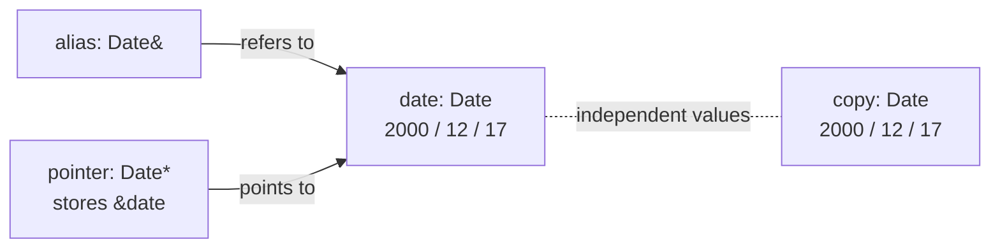
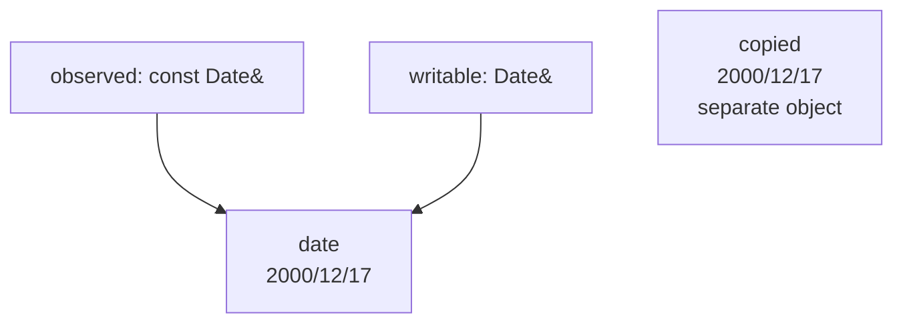
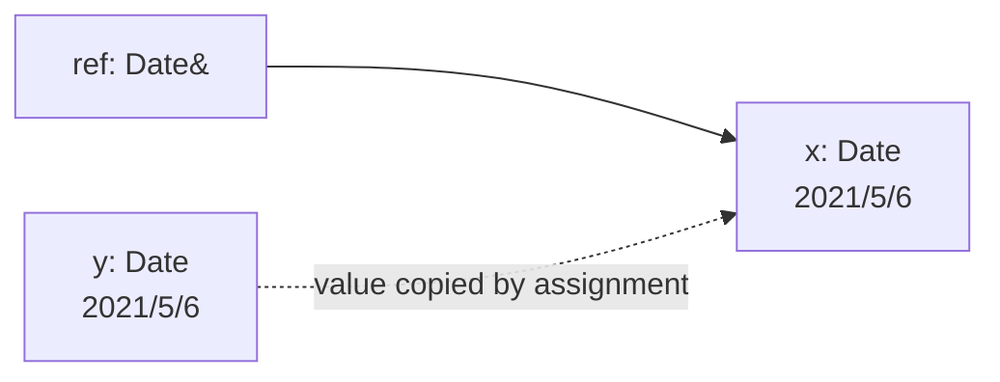
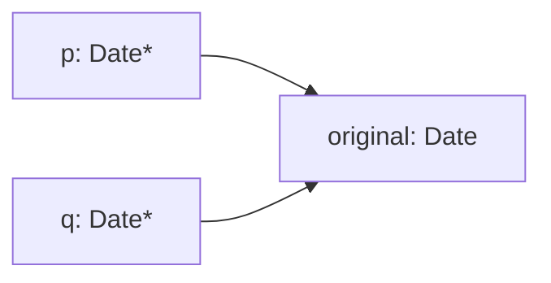
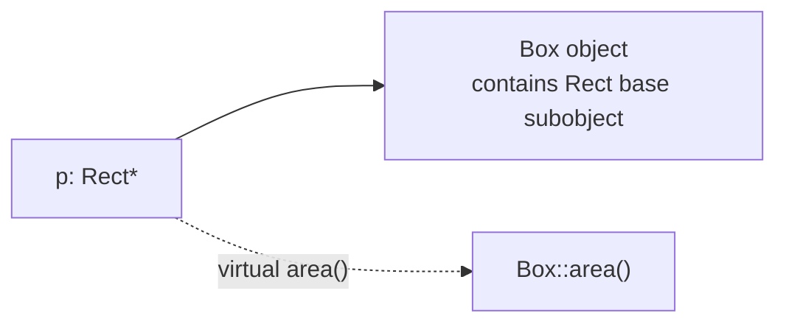

# Pointers, References, and the Objects Behind Them

*An experiment with `Date`, then a detour into inheritance, copying, and virtual functions.*

I used to find C++ references a little mysterious. Two different names could print the same date; some assignments changed both, while others changed only one. Once I began printing the addresses, the behavior became much easier to see.

The simplest way I now think about it is: **a value is an object; a reference is another name for an object; a pointer is an object that stores an address**. Most of the surprising behavior comes from confusing those three things.

## 1. One date, three ways to talk about it

```cpp
Date date(2000, 12, 17);
Date copy = date;        // another Date object
Date& alias = date;      // another name for date
Date* pointer = &date;   // pointer stores date's address
```



`copy` starts with equal values but is a different object. `alias` refers to the original object. `pointer` lives somewhere too: `&pointer` is the address *of the pointer variable*, while `pointer` contains the address *of the Date object*.

```cpp
std::cout << &date << '\n';    // address of original object
std::cout << &copy << '\n';    // different address
std::cout << &alias << '\n';   // same address as date
std::cout << pointer << '\n';  // same address as date
std::cout << &pointer << '\n'; // different: address of pointer variable
```

**An address printed for a reference is the referred object's address.** A reference is not an independently reseatable variable, even if a compiler represents it internally using an address.

## 2. Copying is not aliasing

Suppose a method returns a reference to the current object:

```cpp
class Date {
    int year_, month_, day_;
public:
    Date(int y, int m, int d) : year_(y), month_(m), day_(d) {}
    Date& getDate() { return *this; }
    const Date& getDate() const { return *this; }
    void setDate(int y, int m, int d) { year_=y; month_=m; day_=d; }
    void print() const {
        std::cout << year_ << '/' << month_ << '/' << day_ << '\n';
    }
};

Date date(2000, 12, 17);
Date copied = date.getDate();          // copy construction
const Date& observed = date.getDate(); // aliases original, read-only via observed
Date& writable = date.getDate();      // aliases original, writable
```

The return type `Date&` does **not** force the recipient to be a reference. The declaration on the receiving side decides whether it creates a new `Date` (`Date copied`) or binds an alias (`Date& writable`).



Now consider:

```cpp
Date replacement(2021, 5, 6);
date = replacement;

copied.print();    // 2000/12/17
observed.print();  // 2021/5/6
writable.print();  // 2021/5/6
```

The aliases reflect the original object's new value. The copy remains unchanged.

## 3. The most important reference surprise: assignment does not rebind

```cpp
Date x(2000, 12, 17);
Date y(2021, 5, 6);
Date& ref = x;

ref = y; // assigns y's VALUE into x, it does not make ref refer to y
```



After this, `&ref == &x` is still true. A C++ reference stays bound to the same object for its entire lifetime. **A reference assignment is an assignment *through* the reference.**

Compare with a pointer, which you *can* redirect:

```cpp
Date* ptr = &x;
ptr = &y;     // ptr now points to y; x is unchanged
*ptr = x;     // copies x's value into y; ptr still points to y
```

`ptr = &y` changes the pointer's stored address; `*ptr = x` changes the pointed-to `Date`.

## 4. `const Date&`: same object, limited access

Your first experiment used a member that returns `const Date&`:

```cpp
const Date& getDate() { return *this; }
```

This returns a read-only view of the *same object* through the returned reference, not a copied object. So:

```cpp
Date date(2000, 12, 17);
const Date& a = date.getDate(); // OK
Date b = date.getDate();        // OK: copies the returned Date
// Date& c = date.getDate();    // error: cannot drop const
```

And you can't assign through the read-only reference:

```cpp
// a = Date(2021, 5, 6); // error: assignment requires modifying a const Date
```

But **`const` on the reference doesn't freeze an originally mutable object**. If someone else updates `date`, `a` sees the update:

```cpp
date.setDate(2021, 5, 6);
a.print(); // 2021/5/6
```

That matters for understanding `const`: it constrains *what can be done via a particular access path*. It is not necessarily global immutability.

There is one related design improvement. Prefer `const Date& getDate() const` if callers should be allowed to call it on const `Date` objects; the trailing `const` applies to `*this` inside the method.

## 5. Why getters often have trailing `const`

```cpp
int getYear() const { return year_; }
void print() const {
    std::cout << getYear() << '\n';
}
void printDate(const Date& d) {
    d.print(); // requires Date::print() to be callable on const Date
}
```

A `const Date&` can only call member functions that are `const`-qualified (or otherwise permitted for const objects). A `const` member can call other `const` members, but it need not call *only* members: it can call free functions too, and there are controlled exceptions such as `mutable` members. The important rule is that it cannot ordinarily mutate the object's non-`mutable` state.

## 6. A pointer is different from a reference

Your `getDateAnother()` returned `&(*this)`. For a valid `this` pointer, that's equivalent to just returning `this`:

```cpp
Date* getDateAnother() { return this; }
```

Then:

```cpp
Date original(2021, 5, 6);
Date* p = original.getDateAnother();
Date* q = p->getDateAnother();

p->print();     // access through pointer
(*q).print();   // equivalent spelling
std::cout << (p == q) << '\n'; // true: both hold the same address
```



Assigning `q = &another` redirects *q* only; assigning `*q = another` copies a `Date` into the object *q currently points to*. Nothing about `*q = ...` automatically redirects `p` or `q`.

**Safety note:** returning `this` or `*this` is only safe for callers while the original object remains alive. Pointers and references do not automatically extend the lifetime of an existing object.

## 7. A side experiment: inheritance and virtual dispatch

Your `Rect` / `Box` experiment introduces another source of indirection: a `Rect*` can point at a `Box`, and a `virtual` call can dispatch to `Box`'s override at runtime.

```cpp
struct Rect {
    virtual ~Rect() = default;
    virtual int area() const { return 2 * 3; }
};

struct Box : Rect {
    int area() const override { return 42; }
};

Box box;
Rect* p = &box;
std::cout << p->area(); // 42: virtual dispatch to Box::area()
```



The variable `p` has static type `Rect*` but the referred object's dynamic type is `Box`. Virtual dispatch selects the override for the dynamic type.

There's a related detail in your experiment with `++B1` and `++(*R)`: when `operator++` is virtual, calling it through a base-class reference can invoke the derived override. But `operator=` is **not automatically polymorphic**: assignment through `Rect&` operates on the `Rect` subobject unless you explicitly implement a different design.

## 8. A caution from the original `Rect`/`Box` code: owning raw pointers

Your example uses `new` to allocate separate integers and a `char[]` for labels. This is useful for experimenting with pointers, but it introduces extra responsibilities:

- A destructor must release every owned allocation exactly once.
- A copy constructor must make an independent copy of owned resources (your `Rect` and `Box` copy constructors attempt this).
- A copy-assignment operator must also correctly copy *all* owned resources and handle self-assignment; `Box::operator=` in the original experiment copies the base fields and height but not the box name.
- The expressions used for `Box::area()` and `Box::volume()` in the experiment are not the standard surface area/volume formulas for a rectangular box; that is a separate arithmetic issue, not a C++ reference issue.
- Passing a string literal to `char*` is invalid in modern standard C++; use `const char*` or better `std::string`.

For production-style code, using value members instead of owning raw pointers is simpler:

```cpp
struct Rect {
    int length = 0;
    int width = 0;
    virtual ~Rect() = default;
    virtual int area() const { return length * width; }
};

struct Box : Rect {
    int height = 0;
    std::string name;
    int volume() const { return length * width * height; }
};
```

This helps separate the **learning goal**—references, pointers, copying, polymorphism—from manual resource management. If you intentionally manage owned resources, learn the Rule of Three/Five and consider `std::unique_ptr`.

## 9. A quick mental test

```cpp
Date a(2000, 12, 17);
Date b(2021, 5, 6);
Date& ref = a;
Date* ptr = &a;
Date copy = a;

ref = b;
ptr = &b;
ptr->setDate(2030, 1, 1);
```

What do the three objects contain now?

| Expression | Final value | Why |
| --- | --- | --- |
| `a` | 2021/5/6 | `ref = b` copied values into `a` |
| `b` | 2030/1/1 | `ptr` was redirected to `b`, then wrote into it |
| `copy` | 2000/12/17 | its own independent snapshot |
| `ref` | 2021/5/6 | it still aliases `a` |
| `*ptr` | 2030/1/1 | it refers to `b` now |

## The takeaway

The rule I remember is short:

> **A copy owns its own value. A reference is another name. A pointer stores an address.**

Once those are clear, most of the tricky-looking expressions in the `Date` experiment stop feeling tricky. They are simply different ways of selecting an object and deciding whether to copy its *value*, change its *value*, or choose a different object to point at.
