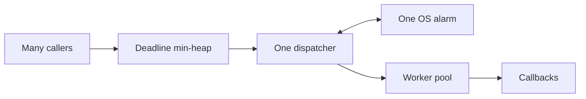
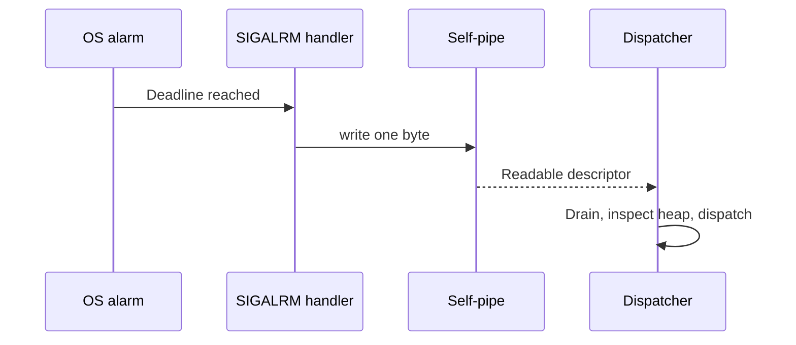
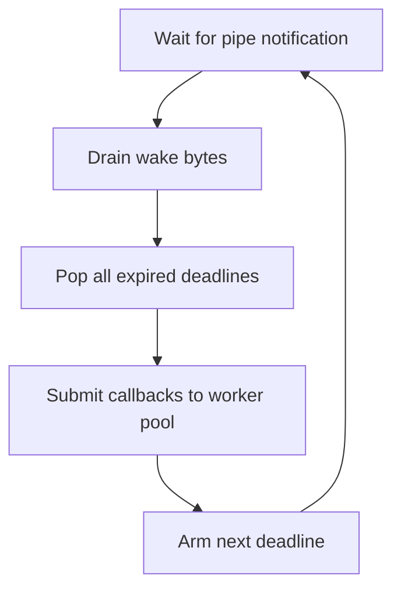

# One Alarm Clock, Many Jobs

*Building a timer dispatcher in C++ without creating a separate thread for every timer.*

I was experimenting with a deceptively simple question: **if a program has hundreds of callbacks scheduled for different times, do we really need hundreds of sleeping threads?**

We don't. We need a way to remember deadlines, one reliable wake-up mechanism, and somewhere to run the callbacks once they become due. That distinction led me to a timer dispatcher built around a priority queue, a single process alarm, a self-pipe, and a worker pool.



## Start with deadlines, not sleeping threads

A caller should be able to say “run this callback three seconds from now” and return immediately:

```cpp
dispatcher.schedule(3s, [] {
    std::cout << "Three seconds passed\n";
});
```

Internally, the dispatcher records an **absolute deadline** using `std::chrono::steady_clock`, so wall-clock corrections won't affect elapsed-time scheduling. A min-heap (`std::priority_queue` with an inverted comparator) keeps the earliest deadline at the top. Insertion and removal cost **O(log n)**; peeking at the next timer costs **O(1)**.

```cpp
struct Timer {
    std::chrono::steady_clock::time_point deadline;
    std::function<void()> callback;
};

struct EarlierDeadline {
    bool operator()(const Timer& a, const Timer& b) const {
        return a.deadline > b.deadline;
    }
};
```

The heap answers one question: **which callback becomes eligible next?** The OS timer only needs to represent that one deadline.

## The surprising part: a pipe is the doorbell

The design uses `setitimer()` to arrange a `SIGALRM` at the earliest deadline. But signal handlers are deliberately restricted: we should not take a C++ mutex, allocate memory, manipulate the heap, or execute user callbacks inside one.

Instead, the handler writes a byte to a **nonblocking pipe**. POSIX `write()` is async-signal-safe. The dispatcher thread waits for the pipe's read end using `select()`, wakes, drains pending notifications, and does the actual work in ordinary thread context.



The same pipe is used when a caller adds a new timer. That matters because a newly scheduled callback might have an *earlier* deadline than the one currently armed. Without a wakeup, it could be delivered late.

## Separate timing from execution

Suppose callback A is due at 3 seconds but takes 9 seconds to finish, while B and C are due at 5 seconds. If the dispatcher directly executes A, it cannot even notice B and C on time.

So the dispatcher **submits expired callbacks to a worker pool** and returns to timing. This is the main separation in the design:

> The dispatcher decides *when work becomes eligible*; the workers decide *where it executes*.



Of course, an exhausted worker pool can still delay the start of a callback. That makes this an efficient **best-effort dispatcher**, not a hard real-time guarantee.

## A short timeline

At t=0, we schedule a slow callback for t=3. At t=2, another thread schedules several callbacks for t=5. The scheduler is notified immediately, but the earliest deadline remains t=3.

At t=3, the alarm wakes the dispatcher. It hands the slow callback to a worker and arms the alarm for t=5. At t=5, it submits the remaining callbacks even if the slow task is still executing. Their actual start time depends on worker availability.

## Small details that matter

A toy dispatcher can appear correct and still fail under load or shutdown. These were the important corners to reason about:

- **Do not execute callbacks while holding the timer-queue lock.** User code can be slow, block, or schedule more work.
- **Drain wakeup bytes correctly.** The pipe signals that *something changed*; the heap contains the actual timer state. A nonblocking pipe helps coalesce bursts safely.
- **Rebuild `fd_set` for each `select()` attempt.** It may be modified, including around interrupted calls.
- **Decide what happens if the worker queue is full.** Ignoring failed submissions silently loses callbacks.
- **Define shutdown semantics.** What happens to future timers, queued callbacks, running callbacks, and new schedules that race with `stop()`?
- **Treat `SIGALRM` / `ITIMER_REAL` as process-global.** Other libraries may compete for the same signal and timer. For a reusable Linux library, `timerfd` can be a cleaner alternative.

There is also a simpler portable alternative: a dispatcher thread using `std::condition_variable::wait_until()`, awakened whenever an earlier timer is scheduled. The signal/self-pipe design is particularly instructive when integrating asynchronous OS signals into descriptor-based event loops.

## What I took away

This wasn't about inventing a new OS timer. It was about **choosing the right ownership of responsibilities**: a heap tracks deadlines, one alarm handles timing, a pipe transfers notifications safely across contexts, and a pool isolates potentially slow callbacks.

It is a small example of a systems principle I keep returning to: concurrency gets easier to reason about when scheduling, notification, and execution are separated.
