# One Alarm Clock, Many Jobs: Building a Simple Timer Dispatcher in C++

Imagine a tiny restaurant with three roles:

- a notebook records when every order should be served;
- one alarm clock rings for the next order;
- a group of cooks performs the actual work.

That is the basic architecture of a timer dispatcher.

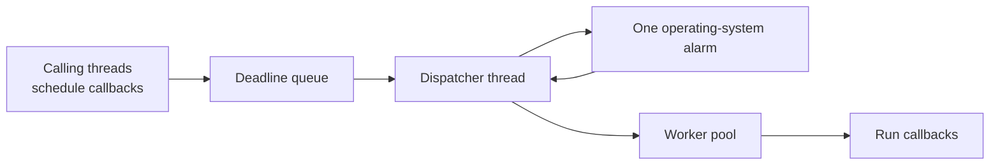

The interesting trick is that we do not create one thread or one operating-
system timer for every callback. We store all deadlines in a priority queue and
arm one alarm for the earliest deadline.

This article explains a Unix-style design using:

- `std::priority_queue` for ordered deadlines;
- `std::chrono::steady_clock` for time calculations;
- `setitimer()` and `SIGALRM` for one process alarm;
- the self-pipe trick for safely notifying ordinary code from a signal handler;
- `select()` for sleeping without busy-waiting;
- a thread pool for callbacks that may take time.

## 1. What does “schedule a callback” mean?

The caller wants to express:

```cpp
dispatcher.schedule(3s, [] {
    std::cout << "Three seconds passed\n";
});
```

The dispatcher converts the relative delay into an absolute deadline:

```text
deadline = steady_clock::now() + delay
```

Absolute deadlines make timers easy to order:

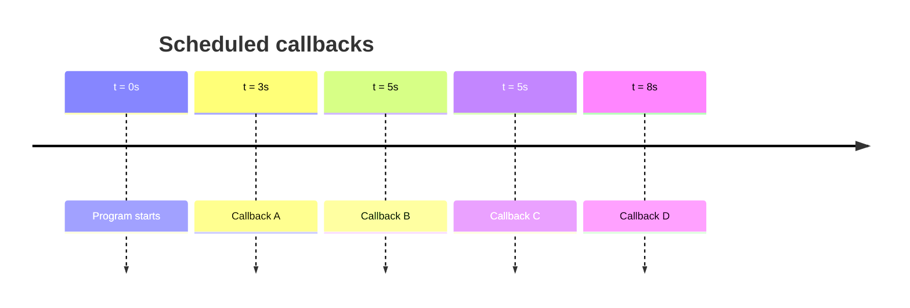

The dispatcher needs to know only which deadline comes first. When that one
expires, it checks whether other deadlines have also passed.

## 2. The complete architecture

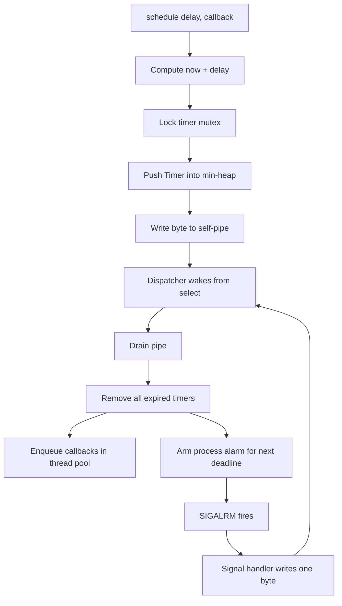

Two different events can wake the dispatcher:

1. A caller schedules a new timer.
2. The operating-system alarm reaches the next deadline.

Both events write to the same pipe. The dispatcher therefore has one simple
wakeup path.

## 3. The timer record

Each scheduled item needs only a deadline and some work:

```cpp
using Callback = std::function<void()>;

struct Timer {
    std::chrono::steady_clock::time_point deadline;
    Callback callback;
};
```

Why use `steady_clock`?

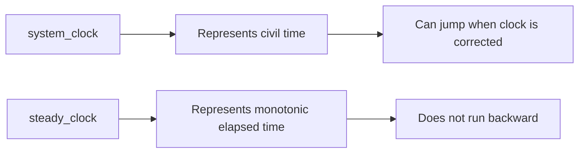

If a user changes the wall clock, “run after three seconds” should still mean an
elapsed three seconds. `steady_clock` is designed for that.

## 4. Turning `priority_queue` into a min-heap

`std::priority_queue` normally exposes the largest element first. A dispatcher
needs the earliest deadline first.

```cpp
struct EarlierDeadline {
    bool operator()(const Timer& left, const Timer& right) const {
        return left.deadline > right.deadline;
    }
};

std::priority_queue<
    Timer,
    std::vector<Timer>,
    EarlierDeadline
> timers;
```

The reversed comparison may initially look wrong. It means that a later timer
has lower priority, leaving the earliest timer at `top()`.

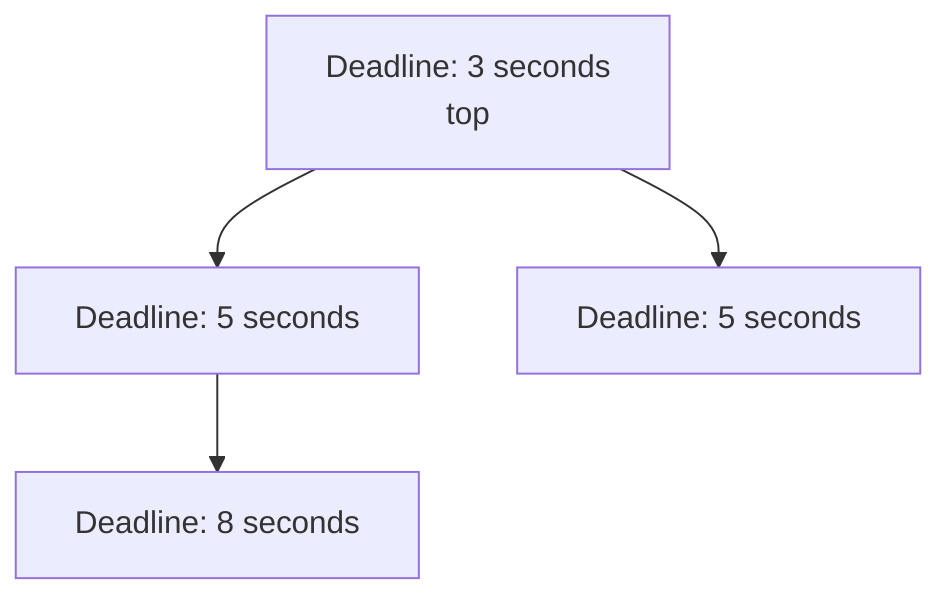

The heap guarantees:

```text
timers.top() is the next deadline
push/pop cost O(log n)
reading top costs O(1)
```

It does not guarantee a stable order between callbacks with identical
deadlines. If equal-deadline order matters, add a monotonically increasing
sequence number.

## 5. What `schedule()` really does

The public method has a short logical path:

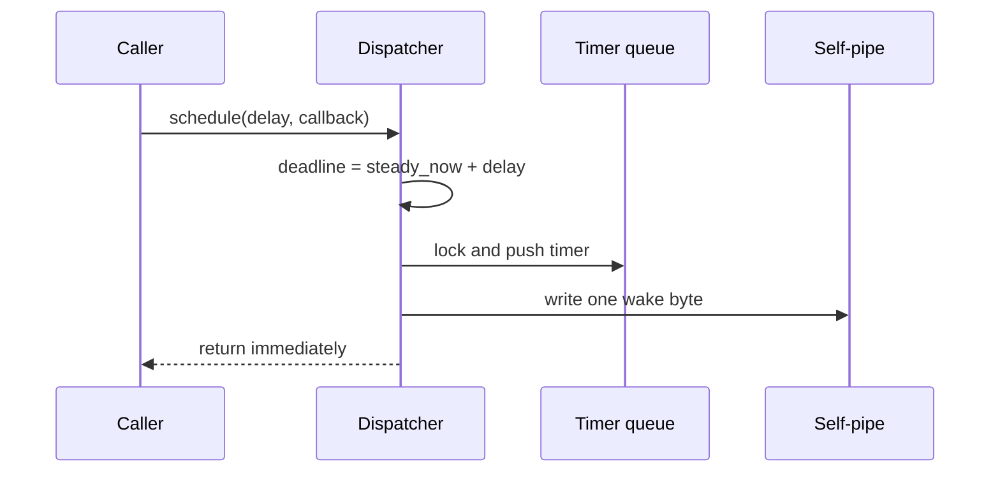

The essential code is:

```cpp
void schedule(std::chrono::milliseconds delay, Callback callback) {
    Timer timer{
        std::chrono::steady_clock::now() + delay,
        std::move(callback)
    };

    {
        std::lock_guard lock(mutex_);
        timers_.push(std::move(timer));
    }

    wake_dispatcher();
}
```

### Why wake the dispatcher for every new timer?

Suppose the dispatcher is currently waiting for a timer due in ten seconds:

```text
currently armed deadline: t = 10s
```

After two seconds, another thread schedules a timer with a one-second delay:

```text
new deadline: t = 3s
```

Without a wakeup, the dispatcher would continue sleeping until ten seconds and
the new timer would be seven seconds late.

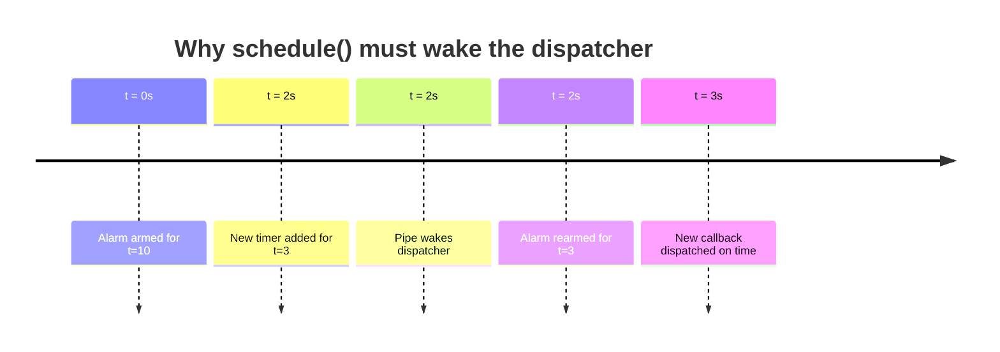

## 6. Why use a pipe?

Signal handlers run in a highly restricted context. Most C++ operations are not
safe there:

```text
Do not lock std::mutex
Do not push into std::queue
Do not allocate memory
Do not call std::function
Do not print with iostreams
```

A POSIX `write()` to a pipe is async-signal-safe. The handler therefore does the
smallest possible job:

```cpp
static void alarm_handler(int) {
    const std::uint8_t byte = 1;
    ::write(pipe_write_fd, &byte, sizeof(byte));
}
```

This converts an asynchronous signal into ordinary file-descriptor
readability—the **self-pipe trick**.

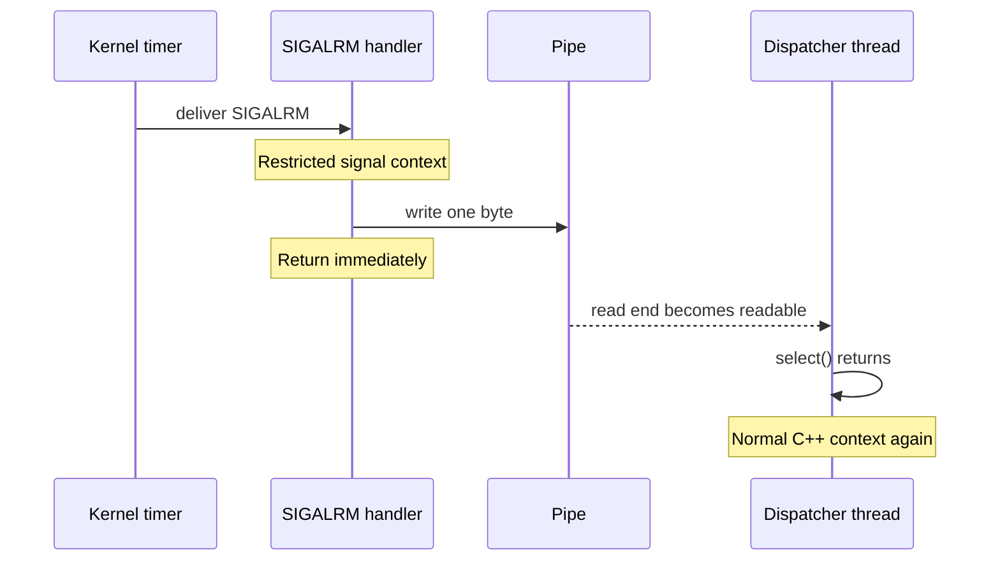

The signal handler does not execute callbacks. It does not touch the timer heap.
It only rings the dispatcher's doorbell.

## 7. Sleeping without busy-waiting

A bad dispatcher repeatedly checks the clock:

```cpp
while (running) {
    if (timer_expired())
        run_it();
}
```

That burns CPU even when the next timer is minutes away.

The dispatcher instead sleeps in `select()` until the pipe becomes readable:

```cpp
fd_set readable;
FD_ZERO(&readable);
FD_SET(pipe_read_fd, &readable);

::select(pipe_read_fd + 1,
         &readable,
         nullptr,
         nullptr,
         nullptr);
```

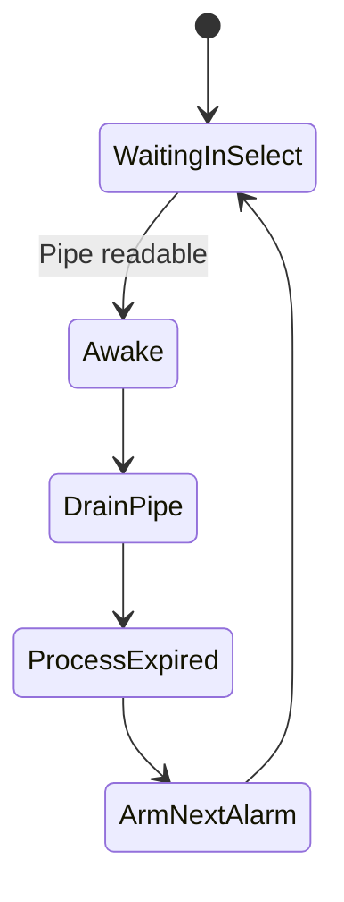

The dispatcher consumes almost no CPU while waiting.

### Why drain the whole pipe?

Several events can write bytes before the worker runs:

```text
[schedule byte][schedule byte][SIGALRM byte][schedule byte]
```

The bytes do not carry individual timer data; the real state is in the heap.
They only mean “something changed.” The worker drains every available byte and
then examines the heap once.

```cpp
std::uint8_t buffer[64];
while (::read(pipe_read_fd, buffer, sizeof(buffer)) > 0) {
    // Discard wake bytes.
}
```

Nonblocking mode makes the final read return instead of sleeping again.

## 8. One alarm represents the earliest deadline

After processing a wakeup, the dispatcher examines `timers_.top()`.

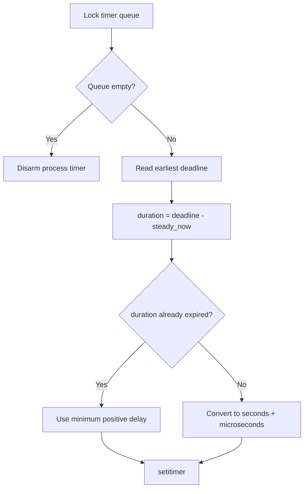

The operating-system timer is not one-to-one with a callback:

```text
many queued Timer objects
          |
          v
one setitimer deadline: the earliest one
```

When the alarm fires, the dispatcher removes every timer whose deadline is less
than or equal to `now`, then arms the alarm for the next remaining deadline.

## 9. Dispatching all expired timers

Several timers may be due by the time the worker wakes:

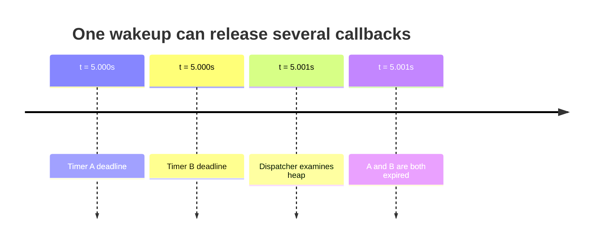

The processing loop is:

```text
look at earliest timer
        |
        v
is deadline <= now? -- no --> stop
        |
       yes
        |
        v
move callback out and pop timer
        |
        v
release timer mutex
        |
        v
submit callback to worker pool
        |
        +--------------------> check next timer
```

The mutex is released before submitting or running arbitrary work. User
callbacks must never run while the timer queue is locked.

## 10. Why callbacks need a worker pool

Imagine these timers:

```text
Timer A: due at 3s, callback takes 9s
Timer B: due at 5s, callback is quick
Timer C: due at 5s, callback is quick
```

If the dispatcher executes callbacks itself:

```mermaid
gantt
    title Callbacks run on dispatcher thread
    dateFormat X
    axisFormat %Ss
    section Dispatcher
    Slow A       :0, 9
    Late B and C :9, 10
```

At time 3, callback A blocks the dispatcher until time 12. B and C cannot even
be dispatched at time 5.

With a pool:

```mermaid
gantt
    title Dispatcher remains responsive
    dateFormat X
    axisFormat %Ss
    section Worker 1
    Slow A :0, 9
    section Worker 2
    Quick B :2, 3
    section Worker 3
    Quick C :2, 3
```

The dispatcher decides **when work becomes eligible**. Pool workers decide
**where the work executes**.

This is an important semantic distinction:

```text
timer expired != callback finished
```

Pool saturation can still delay callback execution, so this is not a hard
real-time scheduler.

## 11. The dispatcher loop

The entire worker thread can be understood as five repeating actions:

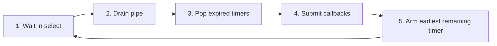

Conceptually:

```cpp
while (running_) {
    wait_for_pipe_event();

    if (!running_)
        break;

    drain_pipe();
    process_expired_timers();
    arm_next_timer();
}
```

The initial call to `schedule()` writes to the pipe, waking the loop so it can
arm the first alarm.

## 12. Starting and stopping safely

### Start

An atomic compare-and-exchange makes repeated `start()` calls harmless:

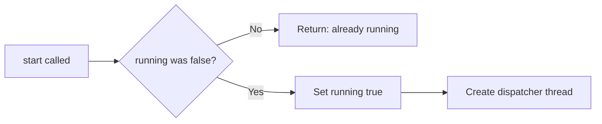

### Stop

The worker may be blocked indefinitely in `select()`. Merely changing a Boolean
does not wake it.

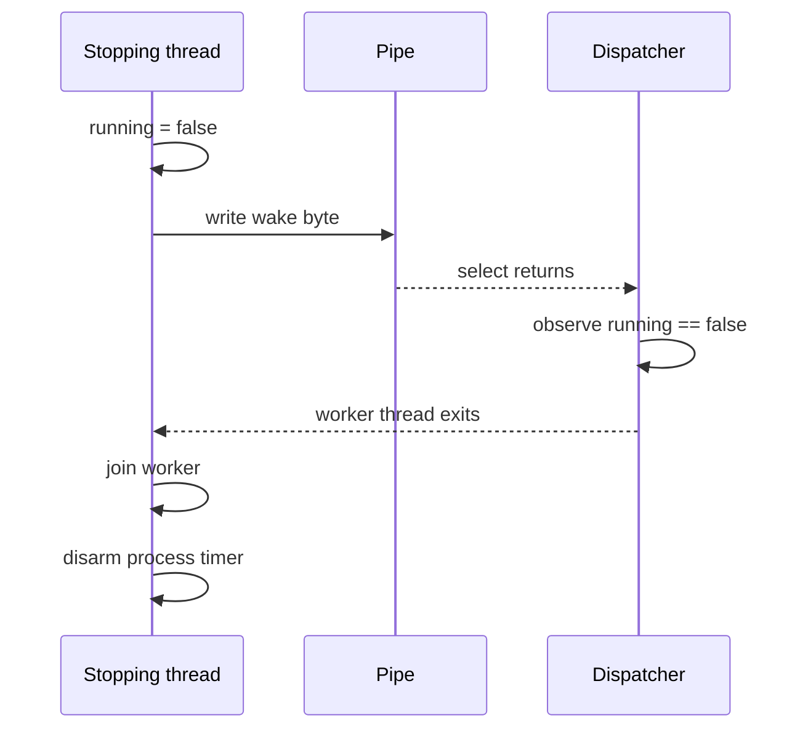

Joining is necessary before destroying the pipe, queue, or mutex used by the
worker.

## 13. An interesting execution story

Suppose the program does this:

```text
t=0: schedule Slow for t=3; Slow takes 9 seconds
t=2: schedule Quick A, B, and C for t=5
t=2: schedule Medium for t=5; Medium takes 3 seconds
```

The control-plane timeline is:

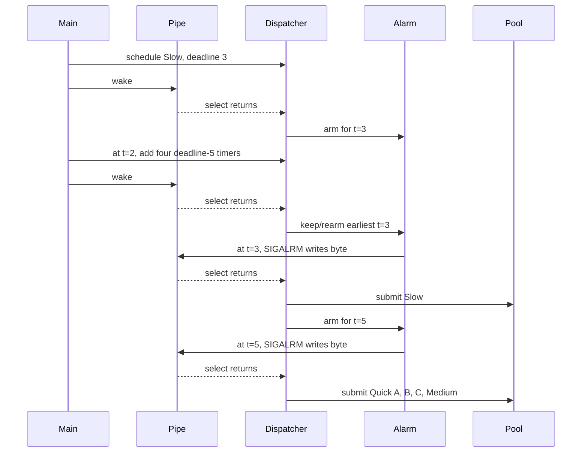

The slow callback does not prevent the dispatcher from noticing the time-5
deadlines. Whether every callback starts immediately depends on available pool
workers.

## 14. Method map

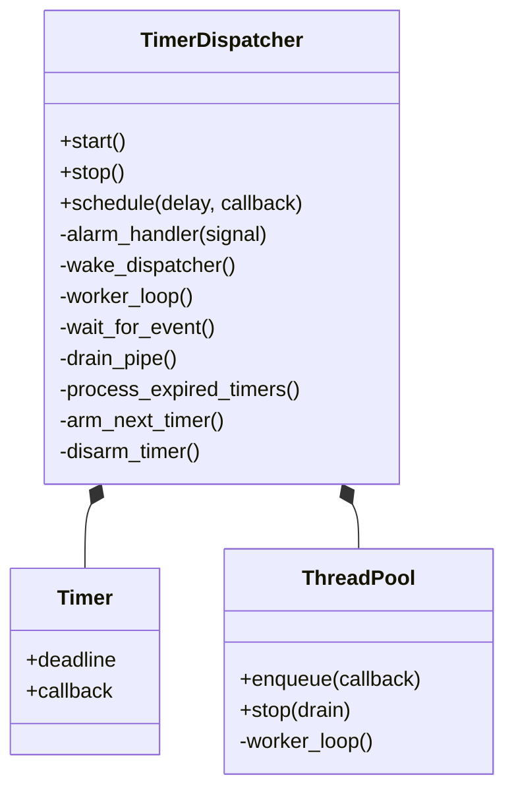

| Method | Responsibility |
|---|---|
| `start()` | Transition to running and create the dispatcher thread. |
| `schedule()` | Compute an absolute deadline, push it, and wake the worker. |
| `alarm_handler()` | Perform the signal-safe pipe write only. |
| `wait_for_event()` | Sleep until the pipe becomes readable. |
| `drain_pipe()` | Coalesce one or many wake notifications. |
| `process_expired_timers()` | Remove due timers and submit their callbacks. |
| `arm_next_timer()` | Point the one OS alarm at the earliest remaining timer. |
| `disarm_timer()` | Clear the OS alarm when no deadline should fire. |
| `stop()` | Wake, join, and shut down without leaving the worker blocked. |

## 15. Correctness traps worth learning from

The architecture is educational, but a robust implementation must address
several sharp edges.

### 15.1 Initialize every configuration member

A constructor parameter does not initialize a similarly named member
automatically:

```cpp
ThreadPool(int worker_count, int max_queue_size)
    : max_queue_size_(max_queue_size) {
    // ...
}
```

Omitting that member initialization leaves `max_queue_size_` indeterminate.
Reading it in:

```cpp
tasks_.size() >= max_queue_size_
```

causes undefined behavior.

### 15.2 `SIGALRM` and `setitimer` are process-global

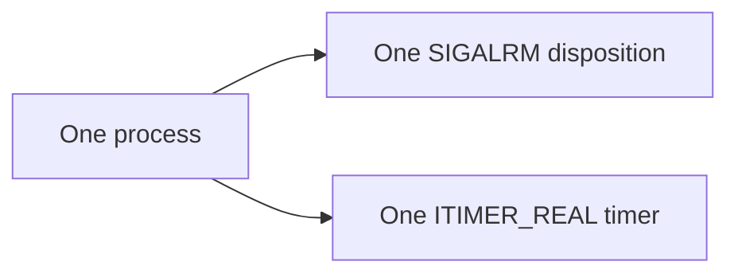

A global `instance_` pointer means only one dispatcher can safely own this
mechanism. Another library in the same process may also use `SIGALRM` or
`ITIMER_REAL`, creating interference.

A production class should either document that exclusivity, restore the old
signal handler on destruction, or prefer an instance-scoped facility such as
Linux `timerfd`.

### 15.3 Check system-call results

These calls can fail:

```text
pipe, fcntl, sigaction, select, read, write, setitimer
```

Ignoring every result can turn a recoverable error into a permanently sleeping
dispatcher or silently missed wakeup.

One useful exception: a nonblocking self-pipe write can return `EAGAIN` when the
pipe is already full. The pipe is already readable in that case, so the wakeup
condition still exists—but the condition should be handled intentionally.

### 15.4 Rebuild `fd_set` when retrying `select`

`select()` may modify its `fd_set` arguments. If it returns after interruption,
reinitialize the set before retrying:

```text
loop:
    FD_ZERO
    FD_SET
    call select
    if errno == EINTR, repeat from FD_ZERO
```

### 15.5 Do not silently lose callbacks

A bounded pool is good protection against unlimited memory growth, but
`enqueue()` can reject work. The dispatcher must decide what rejection means:

- retry later;
- run inline, accepting possible dispatcher delay;
- send it to an overflow queue;
- call an error handler;
- explicitly drop it and record a metric.

Ignoring a false return silently loses an expired timer.

### 15.6 Define shutdown semantics

When stopping, decide what happens to:

- timers whose deadlines have not arrived;
- expired callbacks waiting in the pool;
- callbacks already executing;
- new `schedule()` calls racing with shutdown.

“Stop immediately” and “drain all accepted work” are both reasonable, but they
are different APIs.

## 16. A simpler portable alternative

If signals and file descriptors are not a learning requirement, one dispatcher
thread can use `std::condition_variable::wait_until()`.

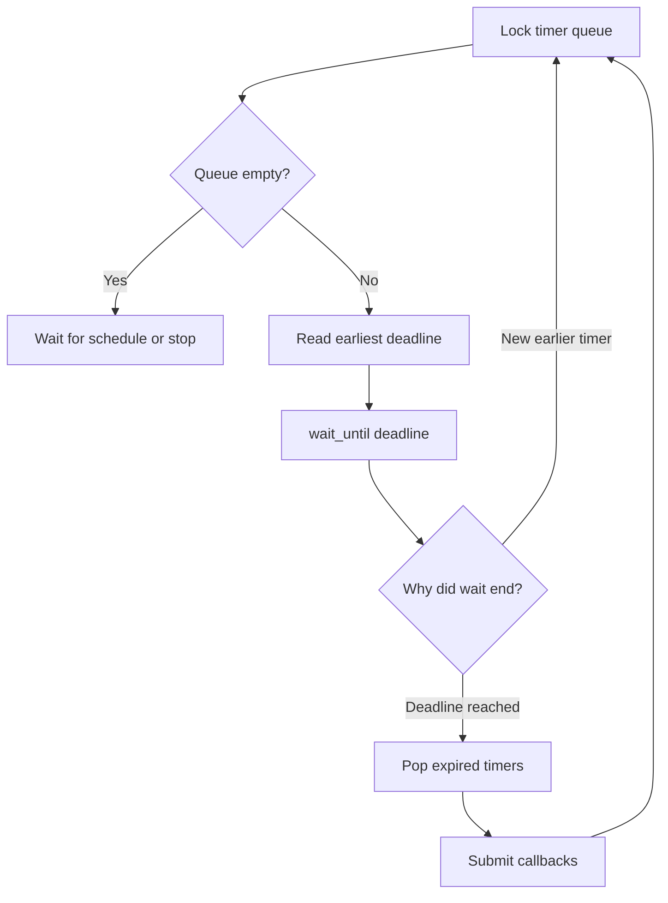

`schedule()` pushes a timer and calls `condition_variable::notify_one()`. That
wakes the dispatcher so it can reconsider whether the new item is earlier.

This version is easier to make multi-instance and portable. The signal/self-
pipe version is valuable when integrating signals into an FD-based Unix event
loop or when learning how asynchronous signal notification is safely handed to
normal code.

## 17. The whole dispatcher on one page

```mermaid
flowchart TD
    A[Caller schedules callback] --> B[Compute steady-clock deadline]
    B --> C[Push into min-heap under mutex]
    C --> D[Write wake byte]
    D --> E[select returns]
    E --> F[Drain pipe]
    F --> G[Read steady-clock now]
    G --> H{Earliest deadline <= now?}
    H -- Yes --> I[Pop timer]
    I --> J[Submit callback to pool]
    J --> H
    H -- No --> K{Queue empty?}
    K -- Yes --> L[Disarm OS timer]
    K -- No --> M[Arm OS timer for earliest deadline]
    L --> N[Wait in select]
    M --> N
    N -->|schedule wake| E
    N -->|SIGALRM writes pipe| E
```

The central idea is elegant:

> Keep every logical timer in a heap, represent only the earliest deadline with
> one physical alarm, turn the signal into a normal pipe event, and move slow
> callbacks away from the timing thread.

That separation gives each component one job:

```text
priority queue  -> what expires next?
OS alarm        -> when should the dispatcher wake?
self-pipe       -> how does the signal notify normal code safely?
dispatcher      -> which callbacks are now eligible?
thread pool     -> where should callback work execute?
```
